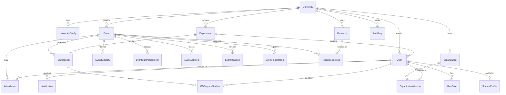

# Implementation Plan: University Event Coordination, Approval & Attendance Management Platform

**Project:** University Event Coordination, Approval & Attendance Management Platform  
**Architecture Style:** Modular Monolith (Controller → Service → Repository)  
**Target Environments:** macOS / Linux / Docker-ready Node.js & PostgreSQL  
**Current Status:** Pre-Implementation Architectural Baseline  
**Document Date:** 2026-10-14  

---

## Executive Summary & Workspace Inspection Findings

### Workspace Inspection
- **Workspace Directory:** `/Users/eamil/Documents/Sem 3/Software Engineering/Attendance`
- **Initial Workspace State:** The directory was clean/empty prior to architectural documentation. No conflicting git repositories or legacy code were present.
- **Development Runtime:** Node.js `v24.21.0` and npm `11.19.0` are installed and operational on macOS.
- **Database Status:** PostgreSQL client (`psql`) and server are not currently configured in the system `$PATH`. Docker and Homebrew are also not present in `$PATH`.
- **Sibling Workspace:** A sibling directory (`../Project`) contains an older Python testing assignment, which remains untouched and isolated.

### Required Setup Actions
1. Initialize local Git repository with `.gitignore`.
2. Configure PostgreSQL access:
   - *Option A (Recommended for local native execution):* Install PostgreSQL via Postgres.app, native package, or homebrew, or connect to a dedicated development PostgreSQL instance (e.g., local port 5432 or cloud dev instance like Neon/Supabase).
   - *Option B (Automated CI/Dev Fallback):* Implement an integrated database configuration supporting both real PostgreSQL and `pg-mem` for isolated unit/integration testing when a live PostgreSQL daemon is not active.

---

## Baseline Analysis: Missing Requirements, Contradictions & Architectural Resolutions

During the architectural inspection of the university event coordination domain, several implicit assumptions and potential edge-case contradictions were identified. The following resolutions are formally established as the approved baseline:

| ID | Issue / Ambiguity | Potential Risk | Architectural Resolution |
|---|---|---|---|
| **GAP-01** | **Multi-Department OD Routing** | An event hosted by Department A (e.g., Mechanical) has student participants registered from Departments B (CSE), C (ECE), and D (Civil). If routed to Organizer's HOD, students receive unauthorized leave outside their department's jurisdiction. | **Resolution:** Decoupled `ODRequest` generation. When an event is approved, student registrations are partitioned by their home department (`student_profile.department_id`). Distinct `ODRequest` records are generated for each student department, routing approvals strictly to the student's own Department HOD/Faculty Advisor. |
| **GAP-02** | **Venue Double-Booking Concurrency** | Simultaneous submissions for the same auditorium or hall could cause race conditions if validated only in application logic. | **Resolution:** Dual-layer defense: Transactional row-level locking (`SELECT ... FOR UPDATE`) in `ResourceService` combined with a PostgreSQL `EXCLUDE USING gist (resource_id WITH =, tstzrange(start_time, end_time) WITH &&)` constraint on `resource_bookings`. |
| **GAP-03** | **Configurable Multi-University Policies** | Hardcoding approval stages (e.g., whether a Dean must sign off, or if OD requires 75% attendance) creates brittle code violating multi-tenant isolation. | **Resolution:** Dedicated `PolicyService` consuming typed JSONB policy definitions from `UniversityConfig`. No business logic may branch on university names or IDs directly. |
| **GAP-04** | **Decoupling Approval vs. OD vs. Attendance** | Confusion between event permission, class leave permission, and physical attendance proof. | **Resolution:** Explicit entity separation: `EventApproval` sanctions the event; `ODRequestStudent` sanctions academic leave; `Attendance` provides cryptographic/immutable timestamps of actual physical presence. |
| **GAP-05** | **Zero External Paid APIs** | Requirement prohibits SendGrid, Twilio, Firebase, or external paid services. | **Resolution:** Native in-app notifications stored in the `Notification` entity, queried via REST polling, accompanied by a mock local console transport for development. |
| **GAP-06** | **Session Revocation & Tenant Security** | Stateless JWT tokens cannot be revoked immediately upon faculty role change or student suspension. | **Resolution:** Stateful session authentication using `express-session` with `connect-pg-simple` backed by PostgreSQL. Immediate server-side invalidation. |

---

## 21 Core Entities Specification & Relational Schema

The platform implements 21 core relational entities adhering to strict foreign key integrity, auditability, and multi-tenant scoping (`university_id`):



### Detailed Entity Dictionary

1. **`University`**
   - **Role:** The root tenant entity.
   - **Attributes:** `id` (UUID, PK), `name` (VARCHAR), `code` (VARCHAR, UNIQUE), `domain` (VARCHAR), `status` (ACTIVE/INACTIVE), `created_at`, `updated_at`.
2. **`UniversityConfig`**
   - **Role:** Dynamic institutional policy configurations consumed by `PolicyService`.
   - **Attributes:** `id` (UUID, PK), `university_id` (FK), `config_key` (VARCHAR), `config_value` (JSONB), `updated_by` (FK User), `updated_at`.
   - **Examples:** Approval tier definitions, OD attendance threshold (e.g., 75%), resource lead time (e.g., 48h).
3. **`Department`**
   - **Role:** Academic subdivisions (e.g., Computer Science, Mechanical).
   - **Attributes:** `id` (UUID, PK), `university_id` (FK), `name` (VARCHAR), `code` (VARCHAR), `created_at`.
4. **`User`**
   - **Role:** System identity for faculty, students, staff, and administrators.
   - **Attributes:** `id` (UUID, PK), `university_id` (FK), `department_id` (FK, Nullable for central admin), `email` (VARCHAR, UNIQUE per tenant), `password_hash` (VARCHAR), `first_name` (VARCHAR), `last_name` (VARCHAR), `phone` (VARCHAR), `status` (ACTIVE/SUSPENDED), `created_at`, `updated_at`.
5. **`UserRole`**
   - **Role:** Role bindings with optional department/entity scope.
   - **Attributes:** `id` (UUID, PK), `user_id` (FK), `role` (ENUM: `SYSTEM_ADMIN`, `UNIVERSITY_ADMIN`, `DEAN`, `HOD`, `FACULTY_ADVISOR`, `STUDENT_ORGANIZER`, `STUDENT_PARTICIPANT`, `RESOURCE_MANAGER`), `department_id` (FK, Nullable), `assigned_at`.
6. **`StudentProfile`**
   - **Role:** Academic metadata linked 1:1 with student users.
   - **Attributes:** `id` (UUID, PK), `user_id` (FK, UNIQUE), `registration_number` (VARCHAR, UNIQUE per tenant), `batch` (VARCHAR), `section` (VARCHAR), `degree_program` (VARCHAR), `current_semester` (INT), `cgpa` (DECIMAL), `created_at`, `updated_at`.
7. **`Organization`**
   - **Role:** Student clubs, technical societies, and departmental associations.
   - **Attributes:** `id` (UUID, PK), `university_id` (FK), `department_id` (FK, Nullable for central clubs), `name` (VARCHAR), `type` (TECHNICAL, CULTURAL, SPORTS, ACADEMIC), `status` (ACTIVE/PROBATION), `created_at`.
8. **`OrganizationMember`**
   - **Role:** Membership and leadership positions in campus organizations.
   - **Attributes:** `id` (UUID, PK), `organization_id` (FK), `user_id` (FK), `role` (PRESIDENT, SECRETARY, TREASURER, CORE_MEMBER, MEMBER), `joined_at`, `is_active` (BOOLEAN).
9. **`Event`**
   - **Role:** The central event proposal and execution entity.
   - **Attributes:** `id` (UUID, PK), `university_id` (FK), `organizer_id` (FK User), `organization_id` (FK, Nullable), `department_id` (FK), `title` (VARCHAR), `description` (TEXT), `category` (TECHNICAL, CULTURAL, SYMPOSIUM, WORKSHOP, SPORTS), `start_time` (TIMESTAMPTZ), `end_time` (TIMESTAMPTZ), `registration_deadline` (TIMESTAMPTZ), `capacity` (INT), `status` (DRAFT, SUBMITTED, FACULTY_REVIEW, HOD_REVIEW, DEAN_REVIEW, APPROVED, REVISION_REQUESTED, REJECTED, CANCELLED, COMPLETED), `created_at`, `updated_at`.
10. **`EventEligibility`**
    - **Role:** Granular registration rules for an event.
    - **Attributes:** `id` (UUID, PK), `event_id` (FK), `allowed_departments` (JSONB/Array), `allowed_batches` (JSONB/Array), `allowed_degree_programs` (JSONB/Array), `min_cgpa` (DECIMAL, Nullable), `max_participants` (INT).
11. **`EventStaffAssignment`**
    - **Role:** Faculty coordinators, judges, and attendance marshals assigned to an event.
    - **Attributes:** `id` (UUID, PK), `event_id` (FK), `user_id` (FK), `role` (FACULTY_INCHARGE, CO_COORDINATOR, ATTENDANCE_VERIFIER, JUDGE), `assigned_at`.
12. **`EventApproval`**
    - **Role:** Multi-tier proposal review trail and decisions.
    - **Attributes:** `id` (UUID, PK), `event_id` (FK), `approver_id` (FK User), `stage` (FACULTY_ADVISOR, HOD, DEAN, RESOURCE_MANAGER), `decision` (APPROVED, REJECTED, REVISION_REQUESTED), `remarks` (TEXT), `decided_at` (TIMESTAMPTZ).
13. **`EventRevision`**
    - **Role:** Historical snapshots and changelogs when a proposal requires modifications.
    - **Attributes:** `id` (UUID, PK), `event_id` (FK), `revision_number` (INT), `changes_summary` (TEXT), `snapshot_data` (JSONB), `submitted_by` (FK User), `submitted_at` (TIMESTAMPTZ).
14. **`EventRegistration`**
    - **Role:** Student enrollment in approved events.
    - **Attributes:** `id` (UUID, PK), `event_id` (FK), `student_id` (FK User), `status` (REGISTERED, WAITLISTED, CANCELLED), `registered_at` (TIMESTAMPTZ), `cancellation_reason` (TEXT, Nullable). Unique constraint on `(event_id, student_id)`.
15. **`ODRequest`**
    - **Role:** Departmental On-Duty (leave of absence) authorization bundle.
    - **Attributes:** `id` (UUID, PK), `university_id` (FK), `event_id` (FK), `department_id` (FK - the reviewing student home department), `submitted_by` (FK User), `duty_date` (DATE), `time_from` (TIME), `time_to` (TIME), `status` (PENDING, APPROVED, REJECTED), `reviewed_by` (FK User, Nullable), `reviewed_at` (TIMESTAMPTZ), `remarks` (TEXT).
16. **`ODRequestStudent`**
    - **Role:** Individual student entries attached to a departmental OD request.
    - **Attributes:** `id` (UUID, PK), `od_request_id` (FK), `student_id` (FK User), `status` (PENDING, APPROVED, REJECTED), `rejection_reason` (TEXT, Nullable).
17. **`Attendance`**
    - **Role:** Verifiable record of physical attendance during event sessions.
    - **Attributes:** `id` (UUID, PK), `event_id` (FK), `user_id` (FK Student), `session_name` (VARCHAR), `marked_by` (FK User), `marked_at` (TIMESTAMPTZ), `status` (PRESENT, ABSENT, LATE), `verification_method` (MANUAL_ROSTER_PORTAL). Unique constraint on `(event_id, user_id, session_name)`.
18. **`Resource`**
    - **Role:** Physical venues, auditoriums, seminar halls, and campus facilities.
    - **Attributes:** `id` (UUID, PK), `university_id` (FK), `name` (VARCHAR), `type` (AUDITORIUM, SEMINAR_HALL, OPEN_AIR_THEATRE, COMPUTER_LAB, CLASSROOM), `capacity` (INT), `location` (VARCHAR), `status` (AVAILABLE, MAINTENANCE, RETIRED).
19. **`ResourceBooking`**
    - **Role:** Reservation slot for a resource during an event.
    - **Attributes:** `id` (UUID, PK), `resource_id` (FK), `event_id` (FK), `start_time` (TIMESTAMPTZ), `end_time` (TIMESTAMPTZ), `status` (PENDING, CONFIRMED, RELEASED, CANCELLED). Protected by PostgreSQL range exclusion constraint.
20. **`Notification`**
    - **Role:** User alerts for approvals, assignments, OD status, and registrations.
    - **Attributes:** `id` (UUID, PK), `user_id` (FK), `title` (VARCHAR), `message` (TEXT), `type` (APPROVAL_REQUIRED, APPROVAL_DECISION, OD_UPDATE, EVENT_UPDATE, REMINDER), `is_read` (BOOLEAN, DEFAULT FALSE), `created_at` (TIMESTAMPTZ).
21. **`AuditLog`**
    - **Role:** Tamper-evident, append-only security and compliance trail.
    - **Attributes:** `id` (UUID, PK), `university_id` (FK), `user_id` (FK User, Nullable for system events), `action` (VARCHAR), `entity_type` (VARCHAR), `entity_id` (UUID), `ip_address` (VARCHAR), `user_agent` (VARCHAR), `old_values` (JSONB), `new_values` (JSONB), `created_at` (TIMESTAMPTZ).

---

## Architecture & Modular Monolith Design

### Layer Responsibilities
```
┌─────────────────────────────────────────────────────────────┐
│                       Client Layer                          │
│               React 19 + TypeScript + Vite                  │
│       Tailored Academic Portals (Student, Faculty, HOD)     │
└──────────────────────────────┬──────────────────────────────┘
                               │ HTTP / HTTPS (REST API)
                               ▼
┌─────────────────────────────────────────────────────────────┐
│                    Controller Layer                         │
│  - Route Definitions (/api/v1/...)                          │
│  - Zod Request Schema Validation                            │
│  - HTTP Status & Error Handling (Uniform ApiResponse)       │
└──────────────────────────────┬──────────────────────────────┘
                               │ Calls
                               ▼
┌─────────────────────────────────────────────────────────────┐
│                     Service Layer                           │
│  - Pure Domain & Workflow Business Logic                    │
│  - Role-Based Access Control & Tenant Authorization Check   │
│  - Dynamic Policy Evaluation via PolicyService              │
│  - Atomic Transaction Orchestration & AuditLog Emission     │
└──────────────────────────────┬──────────────────────────────┘
                               │ Invokes
                               ▼
┌─────────────────────────────────────────────────────────────┐
│                    Repository Layer                         │
│  - Encapsulated Parameterized SQL Queries                   │
│  - Connection Pool Management (`pg`)                        │
│  - Tenant Scoping Filter Enforcement (`WHERE university_id`)│
│  - Isolation Level Controls & Row Locking                   │
└──────────────────────────────┬──────────────────────────────┘
                               │ Queries
                               ▼
┌─────────────────────────────────────────────────────────────┐
│                   PostgreSQL Database                       │
│  - 21 Relational Tables with Foreign Key Constraints        │
│  - GIST Range Exclusion Constraint for Double-Booking       │
│  - `connect-pg-simple` Session Store                        │
└─────────────────────────────────────────────────────────────┘
```

### Clean Directory Layout
```
Attendance/
├── docs/
│   └── architecture/
│       ├── decisions.md
│       └── implementation-plan.md
├── database/
│   ├── migrations/
│   │   ├── 001_extensions_and_tenants.sql
│   │   ├── 002_core_users_and_roles.sql
│   │   ├── 003_organizations_and_members.sql
│   │   ├── 004_resources_and_conflict_constraints.sql
│   │   ├── 005_events_revisions_and_approvals.sql
│   │   ├── 006_registrations_and_eligibility.sql
│   │   ├── 007_od_requests_and_routing.sql
│   │   ├── 008_attendance_marking.sql
│   │   └── 009_notifications_and_audit_trail.sql
│   └── seeds/
│       ├── 001_demo_universities_and_configs.sql
│       └── 002_demo_users_departments_resources.sql
├── backend/
│   ├── package.json
│   ├── tsconfig.json
│   └── src/
│       ├── config/              # Environment, DB pool, session config
│       ├── controllers/         # HTTP request handlers
│       ├── services/            # Domain logic, PolicyService, AuditService
│       ├── repositories/         # Parameterized DB access
│       ├── middlewares/         # Auth, TenantContext, RBAC, Validation
│       ├── models/              # TypeScript domain types & interfaces
│       ├── schemas/             # Zod validation schemas
│       ├── routes/              # Express API routers
│       └── server.ts            # Application bootstrap
├── frontend/
│   ├── package.json
│   ├── tsconfig.json
│   ├── vite.config.ts
│   └── src/
│       ├── api/                 # Strongly typed Axios/Fetch clients
│       ├── components/          # Reusable UI design system & layout
│       ├── contexts/            # AuthContext, NotificationContext
│       ├── pages/               # Student, Faculty, HOD, Admin dashboards
│       ├── styles/              # Design tokens & responsive CSS
│       └── App.tsx
└── tests/
    ├── unit/                   # PolicyService, domain utility tests
    ├── integration/            # Supertest API & database tests
    └── e2e/                    # Playwright browser journeys
```

---

## Detailed PolicyService Engine Design

Hardcoding business rules to any university is forbidden. The `PolicyService` loads, validates, and evaluates policies:

### Policy Configuration Schema (`UniversityConfig`)
```json
{
  "approval_workflow": {
    "default_stages": ["FACULTY_ADVISOR", "HOD"],
    "require_dean_if_budget_exceeds": 50000,
    "require_dean_if_inter_university": true,
    "auto_approve_internal_meeting": false
  },
  "resource_booking": {
    "min_advance_notice_hours": 48,
    "max_advance_booking_days": 60,
    "allow_overlapping_setup_time": false
  },
  "od_authorization": {
    "min_student_attendance_percentage": 75.0,
    "max_od_days_per_semester": 10,
    "requires_hod_approval": true,
    "auto_reject_if_under_cgpa": null
  },
  "attendance_marking": {
    "allow_post_event_marking_hours": 24,
    "require_staff_verification": true
  }
}
```

### PolicyService API Interface
- `getApprovalStages(universityId: string, eventDetails: Partial<Event>): Promise<ApprovalStage[]>`
- `validateResourceBookingLeadTime(universityId: string, startTime: Date): Promise<{ valid: boolean; message?: string }>`
- `evaluateODEligibility(universityId: string, studentId: string): Promise<{ eligible: boolean; reason?: string }>`
- `isAttendanceWindowOpen(universityId: string, eventEndTime: Date): Promise<boolean>`

---

## End-to-End Workflow Lifecycles

### 1. Event Proposal & Multi-Tier Review Workflow
```
[Organizer] Draft Proposal & Select Venue
     │
     ▼ (Submits)
[Event: SUBMITTED] ──► [ResourceBooking: PENDING]
     │
     ▼
[Stage 1: Faculty Advisor Review]
     ├── Approved ──► [Stage 2: Department HOD Review]
     │                      ├── Approved ──► (Policy Check: Dean Required?)
     │                      │                      ├── Yes ──► [Stage 3: Dean Review] ──► APPROVED
     │                      │                      └── No  ─────────────────────────────► APPROVED
     │                      ├── Revision Requested ──────────────────────────────┐
     │                      └── Rejected ──► CANCELLED / REJECTED                │
     └── Revision Requested ─────────────────────────────────────────────────────┼─► [Event: REVISION_REQUESTED]
                                                                                 │          │
                                                                                 │          ▼ (Organizer edits & resubmits)
                                                                                 │   [EventRevision Created]
                                                                                 └──────────┘
```

When an event transitions to `APPROVED`:
- Associated `ResourceBooking` transitions from `PENDING` to `CONFIRMED`.
- Registration window is scheduled/opened.
- In-app notifications are dispatched to eligible students and organizers.

### 2. Department-Wise OD Authorization Routing
```
[Approved Event with Registrations]
           │
           ▼
[Partition Registrations by Student Home Department]
     ├── Dept: Computer Science (12 Students) ──► ODRequest #101 ──► CSE HOD Dashboard
     ├── Dept: Mechanical Eng. (8 Students)   ──► ODRequest #102 ──► MECH HOD Dashboard
     └── Dept: Electrical Eng. (5 Students)   ──► ODRequest #103 ──► EEE HOD Dashboard
                                                        │
                                                        ▼ (Each HOD independently reviews)
                                            Approved / Rejected per Student
                                                        │
                                                        ▼
                                            ODRequestStudent.status updated
                                            Notification sent to each student
```

### 3. Actual Attendance Recording
1. During or immediately following the event session, the assigned staff verifier (`EventStaffAssignment`) opens the event attendance roster.
2. The roster displays registered students alongside their department OD approval status as contextual aid.
3. Verifier records `PRESENT`, `ABSENT`, or `LATE`.
4. Submission writes to `Attendance` with `marked_by` and `marked_at` within a database transaction.
5. `AuditLog` captures the exact roster change.

---

## Concurrency Control & Double-Booking Prevention

To eliminate any chance of double-booking campus resources:
1. **Database Constraint:**
   ```sql
   CREATE EXTENSION IF NOT EXISTS btree_gist;

   ALTER TABLE resource_bookings
   ADD CONSTRAINT no_overlapping_confirmed_bookings
   EXCLUDE USING gist (
     resource_id WITH =,
     tstzrange(start_time, end_time) WITH &&
   ) WHERE (status IN ('PENDING', 'CONFIRMED'));
   ```
2. **Transaction Isolation in `ResourceService`:**
   When booking a resource:
   ```typescript
   await db.transaction(async (client) => {
     // 1. Lock resource record to prevent concurrent booking attempts
     await client.query('SELECT id FROM resources WHERE id = $1 FOR UPDATE', [resourceId]);
     
     // 2. Query for conflicts
     const conflicts = await client.query(
       `SELECT id FROM resource_bookings
        WHERE resource_id = $1
          AND status IN ('PENDING', 'CONFIRMED')
          AND tstzrange(start_time, end_time) && tstzrange($2, $3)`,
       [resourceId, startTime, endTime]
     );
     if (conflicts.rows.length > 0) {
       throw new ConflictError('The requested resource is already reserved for this time slot.');
     }

     // 3. Insert reservation
     return await client.query(...);
   });
   ```

---

## Phased Backlog, Dependencies & Acceptance Criteria

### Phase 0: Workspace Foundation & Architecture Baseline
- **Dependencies:** None.
- **Tasks:**
  - Initialize Git repository and `.gitignore`.
  - Establish monorepo structure (`backend/`, `frontend/`, `database/`, `docs/`).
  - Create configuration templates (`.env.example`).
- **Acceptance Criteria:**
  - Clean directory structure committed.
  - Zero sensitive secrets tracked.

### Phase 1: Database Migrations & 21 Core Entities Schema
- **Dependencies:** Phase 0.
- **Tasks:**
  - Write SQL migrations `001` through `009` covering all 21 entities.
  - Configure `btree_gist` extension and range exclusion constraint for `resource_bookings`.
  - Add indexes for multi-tenant queries (`university_id`), email lookups, and booking ranges.
  - Write seed script for demo universities, departments, users, and policy configs.
- **Acceptance Criteria:**
  - Migrations run sequentially without errors.
  - Foreign key cascades/restrictions prevent orphaned records.
  - Exclusion constraint rejects overlapping bookings at SQL level.

### Phase 2: Backend Core, Repositories & PolicyService Engine
- **Dependencies:** Phase 1.
- **Tasks:**
  - Setup Express + TypeScript boilerplate with unified error handling and `ApiResponse` envelope.
  - Implement base repository with connection pooling (`pg`) and tenant context.
  - Implement `PolicyService` with cached JSONB configuration retrieval and validation.
  - Implement `AuditService` for tamper-evident transaction logging.
- **Acceptance Criteria:**
  - PolicyService correctly calculates approval stages and OD thresholds based on `UniversityConfig`.
  - AuditService writes structured diffs for state-changing operations.

### Phase 3: Session Authentication & Multi-Tenant Access Control
- **Dependencies:** Phase 2.
- **Tasks:**
  - Implement `connect-pg-simple` session store and session middleware.
  - Implement password hashing with `bcrypt` (salt rounds: 12).
  - Implement login, logout, password change, and current session inspection endpoints.
  - Implement `authenticate`, `requireRole`, and `requireTenant` middleware.
- **Acceptance Criteria:**
  - Cross-tenant data access attempts return `403 Forbidden` or `404 Not Found`.
  - Sessions persist across server restarts in the PostgreSQL `sessions` table.
  - Passwords never stored or returned in plaintext.

### Phase 4: Event Proposal, Revision & Multi-Stage Approval Workflow
- **Dependencies:** Phase 3.
- **Tasks:**
  - Implement Event Controller, Service, and Repository.
  - Implement multi-stage approval engine (`EventApproval`) routing through Faculty Advisor, HOD, and Dean based on `PolicyService`.
  - Implement proposal revision workflow (`EventRevision`) storing snapshot data.
- **Acceptance Criteria:**
  - Student organizers can submit proposals and upload agenda/budget details.
  - Approvers can Approve, Request Revision, or Reject with mandatory remarks.
  - Revisions maintain historical diffs and notify organizers.

### Phase 5: Resource Management & Conflict-Free Booking Engine
- **Dependencies:** Phase 4.
- **Tasks:**
  - Implement Resource Controller and Repository (venues, halls, equipment).
  - Implement Resource Booking Service with `SELECT FOR UPDATE` and exclusion constraint handling.
  - Implement conflict check API returning available vs. reserved time slots.
- **Acceptance Criteria:**
  - Concurrent requests for the same venue and time window result in exactly one confirmation and one graceful conflict error.
  - Venue schedule view displays accurate reservations.

### Phase 6: Student Event Registration & Eligibility Verification
- **Dependencies:** Phase 5.
- **Tasks:**
  - Implement Registration Service verifying `EventEligibility` (departments, batches, CGPA, capacity).
  - Implement registration capacity decrement with waitlist support.
  - Self-service registration and cancellation for students.
- **Acceptance Criteria:**
  - Ineligible students receive specific rejection messages (e.g., "Minimum CGPA 7.5 required").
  - Over-capacity attempts either transition to waitlist or return capacity exceeded error.

### Phase 7: Department-Wise OD (On-Duty) Routing & Authorization Workflow
- **Dependencies:** Phase 6.
- **Tasks:**
  - Implement automated OD request generation grouping registered students by home `department_id`.
  - Implement Department HOD / Advisor review interface and endpoints.
  - Implement individual student approval/rejection flags within the batch.
- **Acceptance Criteria:**
  - CSE HOD only sees OD requests for CSE students, even if the event was hosted by Mechanical.
  - Approving or rejecting an OD request updates student status and triggers notifications.

### Phase 8: Roster-Based Attendance Marking & Verification Engine
- **Dependencies:** Phase 7.
- **Tasks:**
  - Implement event attendance roster query combining registration + OD status.
  - Implement session attendance marking endpoint with verification staff role checks.
  - Enforce attendance modification time windows via `PolicyService`.
- **Acceptance Criteria:**
  - Designated staff verifier can mark Present/Absent/Late with one-click bulk save.
  - AuditLog records who marked attendance, when, and from what IP address.

### Phase 9: In-App Notifications & Audit Trail Inspection
- **Dependencies:** Phase 8.
- **Tasks:**
  - Implement Notification Service writing in-app alerts on workflow transitions.
  - Notification polling and mark-as-read endpoints.
  - Admin audit trail search and export endpoint.
- **Acceptance Criteria:**
  - Users receive instant in-app alerts when their submissions are reviewed or updated.
  - Audit trail provides complete history of changes for accreditation reviews.

### Phase 10: Responsive Single-Page Application (SPA)
- **Dependencies:** Phases 3 to 9.
- **Tasks:**
  - Initialize React + TypeScript + Vite frontend.
  - Build modern academic design system (accessible typography, harmonious color palette, glassmorphism cards, responsive layouts).
  - Implement role-tailored dashboards:
    - Student Portal (Browse events, register, view OD status, view attendance record).
    - Faculty / HOD Portal (Review proposals, approve department OD requests, assign staff).
    - Resource Manager Portal (Venue calendar, conflict overview, equipment status).
    - University Admin Portal (Department management, user roles, policy configuration).
- **Acceptance Criteria:**
  - High aesthetic quality, fully responsive across mobile, tablet, and desktop viewports.
  - Form validation with immediate feedback and clear error states.

### Phase 11: End-to-End Verification & Automated Testing Suite
- **Dependencies:** Phase 10.
- **Tasks:**
  - Unit tests for `PolicyService` and domain calculation rules.
  - Supertest API integration tests verifying auth, tenant isolation, and booking constraints.
  - Playwright E2E journey verifying proposal → approval → registration → OD → attendance.
- **Acceptance Criteria:**
  - 100% test execution with zero fabricated results.
  - Clean test report documented.

---

## Explicit Project Assumptions

1. **Authentication Mode:** Institutional Single Sign-On (SAML/OAuth) is not required for this microproject; stateful session-based email/password authentication satisfies requirements.
2. **Attendance Verification:** In accordance with Non-Negotiable #4 (no QR, no facial recognition, no mobile apps), attendance verification is performed through the web portal roster by authorized event staff coordinators.
3. **Storage:** All attachments (e.g., event proposal documents or budgets) are stored locally in an uploads directory or referenced via URLs; no third-party S3/cloud storage is required.
4. **Timezones:** All event scheduling and booking constraints use UTC internally (`TIMESTAMPTZ`) and display in local campus time (`Asia/Kolkata` / IST).

---

## Risk Management Matrix

| Risk | Impact | Probability | Mitigation Strategy |
|---|---|---|---|
| **PostgreSQL local server absence on dev machine** | High | High | Document exact installation steps (Postgres.app / Homebrew / Cloud DB URI); provide `pg-mem` fallback for isolated unit/integration tests so build verification succeeds even without a local daemon. |
| **Concurrent double-booking under race conditions** | High | Low | Enforce PostgreSQL `EXCLUDE` constraint with `btree_gist` alongside pessimistic locking (`SELECT ... FOR UPDATE`). |
| **Cross-department OD review bottleneck** | Medium | Medium | Automated email/in-app reminders to HODs 48 hours prior to event; visual alerts on faculty dashboards. |
| **Accidental cross-tenant data leak** | Critical | Low | Repository-level tenant encapsulation where `university_id` is automatically injected into every query. |

---

## Exact Next Step

1. **Foundation Setup:**
   - Initialize git repository and `.gitignore`.
   - Setup project directories (`backend`, `frontend`, `database`, `tests`).
   - Create the initial database migration scripts (`001` through `009`) defining the complete 21 core entities, foreign keys, and PostgreSQL exclusion constraints.
2. Present this architectural baseline to the user for formal review and confirmation before proceeding to Phase 0 and Phase 1 execution.
